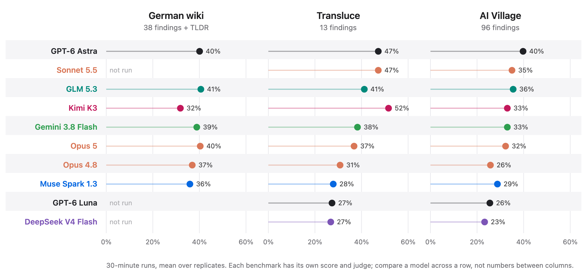
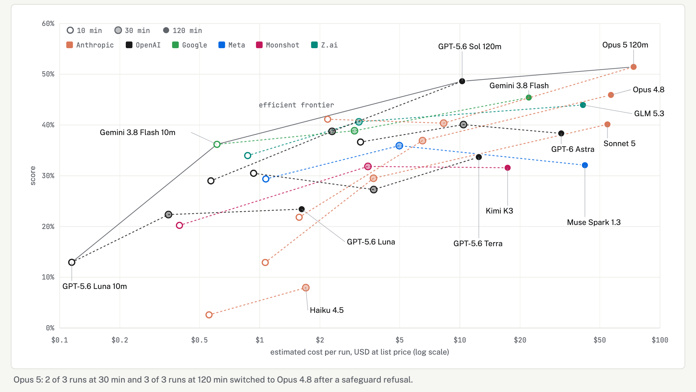
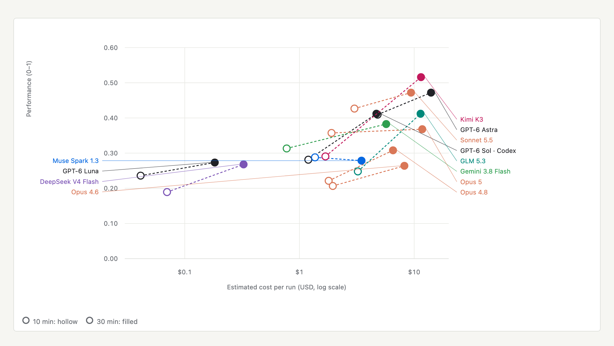
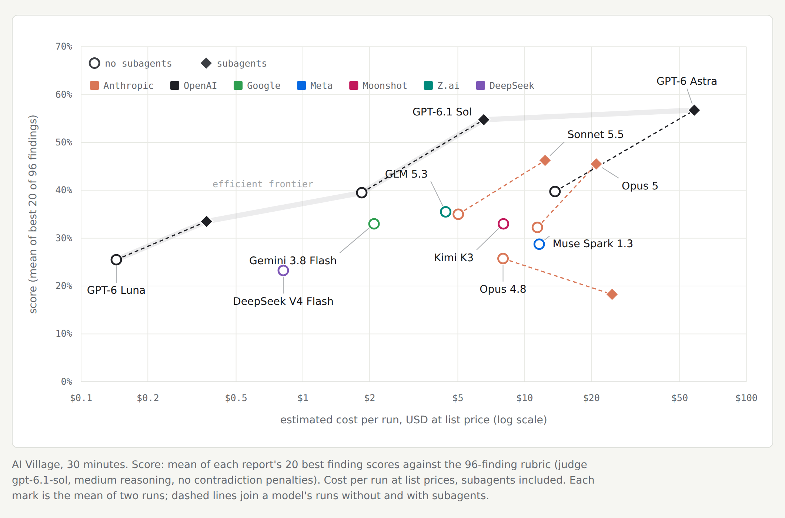

# SlopvestigatorBench

Can an AI agent investigate raw logs of AI agents misbehaving and find what human
investigators found? Three benchmarks ask this about three real incidents. In each, the
agent gets the logs in a sandbox with no internet and a time budget, writes a report, and a
judge scores the report against findings taken from human write-ups.

**The best agents recover about half of what the humans found, and which model is best
depends on the incident.** At 30 minutes, GPT-6 Astra is at or near the top on all three,
while Kimi K3 leads on Transluce (52%) but is in the lower half on the German wiki (32%). Each
benchmark has its own score and judge, so compare a model across a row, not numbers
between columns.



The German wiki benchmark is written up on LessWrong:
[How good are slop-vestigators?](https://www.lesswrong.com/posts/wt4kk6vFPEhkXvF8Q/how-good-are-slop-vestigators)

| benchmark | the logs | source | details |
|---|---|---|---|
| German wiki report | ~18,000 posts on a public wiki where autonomous OpenAI agents coordinated on a web-retrieval task | [collusion.wiki](https://collusion.wiki/index.html) | [`benchmarks/german-wiki/`](benchmarks/german-wiki/README.md) |
| Transluce report | 38,158 urlquery.net web scans that Transluce linked to autonomous agents (2026) | [Transluce](https://transluce.org/agent-activity) | [`benchmarks/transluce/`](benchmarks/transluce/README.md) |
| AI Village report | the full AI Village logs, where frontier agents share a chat, run their own computers and pursue goals (April 2025 to September 2026) | [AI Village](https://theaidigest.org/village), dataset [`aidigestorg/ai-village`](https://huggingface.co/datasets/aidigestorg/ai-village) | [`benchmarks/aivillage/`](benchmarks/aivillage/README.md) |

Each details page says how to get the data, run a trial and grade it.

## Score against cost

Every plot below puts score against the estimated cost of a run at list prices, on a log
scale, with one colour per lab.

**German wiki.** The score is 70% finding coverage (38 findings from the human report) and
30% a judged TLDR. The best run, Opus 5 at 120 minutes, scores 51%; GPT-5.6 Sol reaches
49% for a seventh of the cost.



**Transluce.** The score is the weighted mean of 13 reviewed headline findings, each graded
by GPT-6 Astra. Three valid reports per model and time limit.



**AI Village.** The score is the mean of a report's 20 best scores against a 96-finding
rubric, graded by GPT-6.1 Sol. Of the six models run with and without subagents,
subagents raise five by 8 to 17 points and lower Opus 4.8 by 8. GPT-6.1 Sol with subagents
scores close to GPT-6 Astra with subagents at about a ninth of the cost. The judge has
since become stricter: regrading one published report on 21 October 2026 gave 0.41
against the published 0.62, so regrade old reports alongside new ones before comparing.



## Run one

Each benchmark is an Inspect eval in one package, so after `uv sync --frozen` (Python
3.11+, uv and Docker; `scripts/doctor.sh` checks them) a trial is:

```bash
uv run inspect eval slopvestigator_bench/german_wiki_report -T agent=claude --model anthropic/claude-opus-5
uv run inspect eval slopvestigator_bench/transluce_report   -T agent=codex  --model openai/gpt-6-astra
uv run inspect eval slopvestigator_bench/aivillage_report   -T agent=codex  --model openai/gpt-6.1-sol
```

`-T agent=` is `claude` (Claude Code), `codex` (Codex CLI) or `react` (a minimal tool loop
for any Inspect model). Each task grades its report inline with the standard judge
(`configs/standard.toml`: `openai/gpt-6.1-sol`, high effort); set another judge with
`--model-role grader=<model>`, or skip grading with `--no-score`. The
`*_grade` tasks grade reports that already exist.
`scripts/e2e_smoke.sh` runs one short trial of each, end to end.

## What they share

One harness: the config format (`configs/`), prompt rendering, the Docker sandbox, the
three agent harnesses, a subscription runner for logged-in CLIs
(`sandbox/docker/run_trial.sh`) and the grading plumbing. Each benchmark brings its own
data, prompt, rubric and judge. Each has a `MAJOR.MINOR` version with a git tag per
version; [`docs/benchmark-versions.md`](docs/benchmark-versions.md) lists them.

## Layout

```
benchmarks/
  german-wiki/            answer key, rubrics, grades, report corpus, captured wiki pages
  transluce/              manifest, findings rubric, judge and figures
  aivillage/              rubric, judge prompt, results and figures
slopvestigator_bench/     the Inspect tasks, graders and repo paths (shared)
sandbox/                  Docker image, runner, proxy, ReAct scaffold and prompts (shared)
configs/                  trial conditions for all three
scripts/                  data builds, batch grading, report collection;
  viewers/                build_*.py -> HTML views and figures
docs/                     setup, versions, audits; figures/ for this README
tests/
data/, runs/, logs/       gitignored: built data and run outputs
```

## Working on it

Outside contributors: [`CONTRIBUTING.md`](.github/CONTRIBUTING.md) has the fork-to-pull-request
path and, more importantly, which files are evidence rather than code.
[`SECURITY.md`](.github/SECURITY.md) explains why the adversarial content here is subject matter
rather than a defect.

Maintainers: task work happens in linked worktrees under `.worktrees/`; the rules are in
[`AGENTS.md`](AGENTS.md). Checks: `uv run ruff check . && uv run pytest -q`.

## License

MIT — see [`LICENSE`](LICENSE). It covers the code and the benchmark material authored
here. It does not license the third-party content reproduced for research: the captured
collusion.wiki pages in `benchmarks/german-wiki/corpus/`, preserved Ruby package diffs in generated data,
the human investigators' reports in `benchmarks/german-wiki/`, and the model-generated reports
in `benchmarks/german-wiki/reports/` and historical baseline reports. The AI Village logs are AI Digest's, used
under the dataset's research terms, which ask that work using them cite AI Digest / AI Village.

