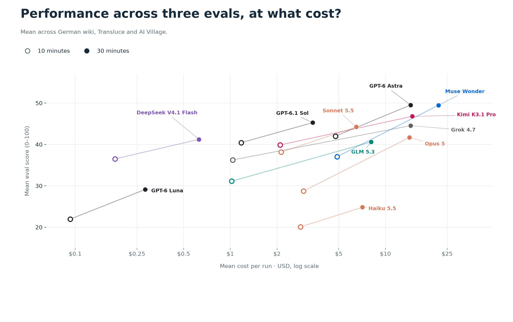
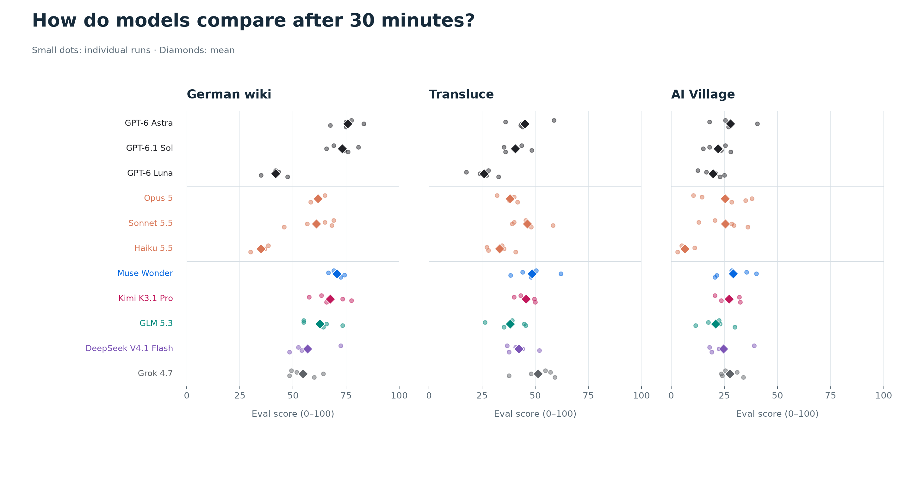

# SlopvestigatorBench

Can an AI agent investigate raw logs of AI agents misbehaving and find what human
investigators found? Three benchmarks ask this about three real incidents. In each, the
agent gets the logs in a sandbox with no internet and a time budget, writes a report, and a
judge scores the report against findings taken from human write-ups.

## Performance and cost across all three evals

The latest evaluation compares 11 models at 10 and 30 minutes, with five trials per
model, eval and time budget. Each point below gives German wiki, Transluce and
AI Village equal weight: it averages the three eval means, rather than pooling
all reports. Open points show 10 minutes; filled points show 30 minutes.



USD is recorded API spend for ReAct, API-equivalent cost for Claude Code, and a
token-based estimate for Codex. It includes all attempts and excludes grading.
The axis is logarithmic. See the
[results snapshot and cost assumptions](benchmarks/results/2026-11-16/README.md).

The 30-minute breakdown shows individual runs as small dots and their means as
diamonds, with one panel per eval. Colors identify model labs.



The average summarizes three different rubric scores, not accuracy. Scoring
retains the existing report exclusions, and models use different scaffolds;
small differences should not be treated as established model or scaffold effects.

The German wiki benchmark is written up on LessWrong:
[How good are slop-vestigators?](https://www.lesswrong.com/posts/wt4kk6vFPEhkXvF8Q/how-good-are-slop-vestigators)

| benchmark | the logs | source | details |
|---|---|---|---|
| German wiki report | ~18,000 posts on a public wiki where autonomous OpenAI agents coordinated on a web-retrieval task | [collusion.wiki](https://collusion.wiki/index.html) | [`benchmarks/german-wiki/`](benchmarks/german-wiki/README.md) |
| Transluce report | 38,158 urlquery.net web scans that Transluce linked to autonomous agents (2026) | [Transluce](https://transluce.org/agent-activity) | [`benchmarks/transluce/`](benchmarks/transluce/README.md) |
| AI Village report | the full AI Village logs, where frontier agents share a chat, run their own computers and pursue goals (April 2025 to September 2026) | [AI Village](https://theaidigest.org/village), dataset [`aidigestorg/ai-village`](https://huggingface.co/datasets/aidigestorg/ai-village) | [`benchmarks/aivillage/`](benchmarks/aivillage/README.md) |

Each details page says how to get the data, run a trial and grade it.

[Earlier experiments](docs/earlier-results.md) used different lineups, rubrics or judges.

## Run one

Each benchmark is an Inspect eval in one package, so after `uv sync --frozen` (Python
3.11+, uv and Docker; `scripts/doctor.sh` checks them) a trial is:

```bash
uv run inspect eval slopvestigator_bench/german_wiki_report -T agent=claude --model anthropic/claude-opus-5
uv run inspect eval slopvestigator_bench/transluce_report   -T agent=codex  --model openai/gpt-6-astra
uv run inspect eval slopvestigator_bench/aivillage_report   -T agent=codex  --model openai/gpt-6.1-sol
```

`-T agent=` is `claude` (Claude Code), `codex` (Codex CLI) or `react` (a minimal tool loop
for any Inspect model). Each task grades its report inline with its own judge; set the
judge with `--model-role grader=<model>`, or skip grading with `--no-score`. The
`*_grade` tasks grade reports that already exist.
`scripts/e2e_smoke.sh` runs one short trial of each, end to end.

## What they share

One harness: the config format (`configs/`), prompt rendering, the Docker sandbox, the
three agent harnesses, a subscription runner for logged-in CLIs
(`sandbox/docker/run_trial.sh`) and the grading plumbing. Each benchmark brings its own
data, prompt, rubric and judge. Each has a `MAJOR.MINOR` version with a git tag per
version; [`docs/benchmark-versions.md`](docs/benchmark-versions.md) lists them.

## Layout

```
benchmarks/
  german-wiki/            answer key, rubrics, grades, report corpus, captured wiki pages
  transluce/              manifest, findings rubric, judge and figures
  aivillage/              rubric, judge prompt, results and figures
slopvestigator_bench/     the Inspect tasks, graders and repo paths (shared)
sandbox/                  Docker image, runner, proxy, ReAct scaffold and prompts (shared)
configs/                  trial conditions for all three
scripts/                  data builds, batch grading, report collection;
  viewers/                build_*.py -> HTML views and figures
docs/                     setup, versions, audits; figures/ for this README
tests/
data/, runs/, logs/       gitignored: built data and run outputs
```

## Working on it

Outside contributors: [`CONTRIBUTING.md`](.github/CONTRIBUTING.md) has the fork-to-pull-request
path and, more importantly, which files are evidence rather than code.
[`SECURITY.md`](.github/SECURITY.md) explains why the adversarial content here is subject matter
rather than a defect.

Maintainers: task work happens in linked worktrees under `.worktrees/`; the rules are in
[`AGENTS.md`](AGENTS.md). Checks: `uv run ruff check . && uv run pytest -q`.

## License

MIT — see [`LICENSE`](LICENSE). It covers the code and the benchmark material authored
here. It does not license the third-party content reproduced for research: the captured
collusion.wiki pages in `benchmarks/german-wiki/corpus/`, preserved Ruby package diffs in generated data,
the human investigators' reports in `benchmarks/german-wiki/`, and the model-generated reports
in `benchmarks/german-wiki/reports/` and historical baseline reports. The AI Village logs are AI Digest's, used
under the dataset's research terms, which ask that work using them cite AI Digest / AI Village.

