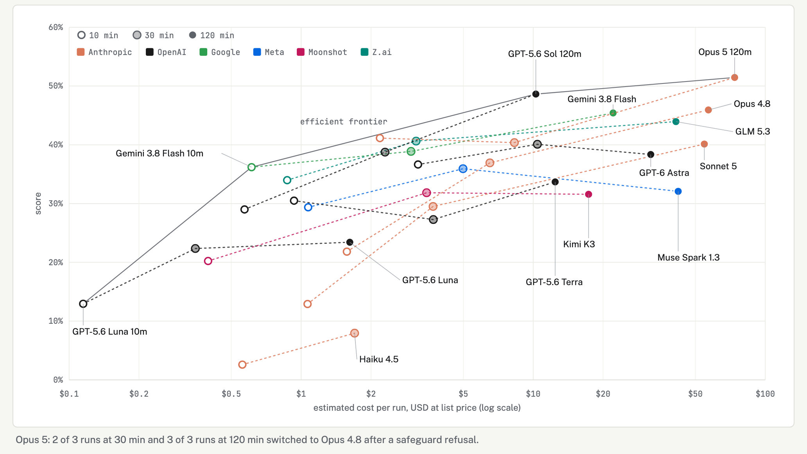
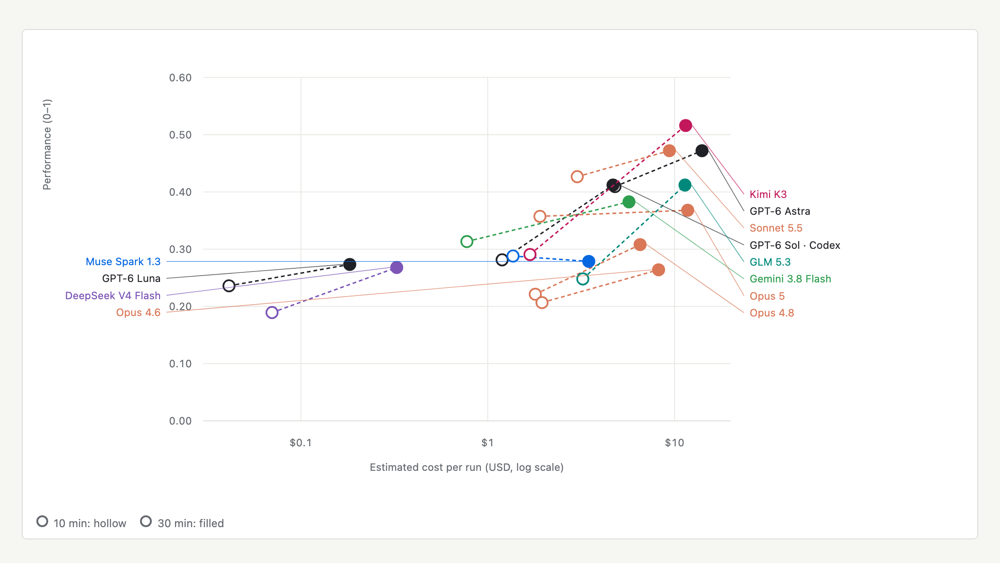
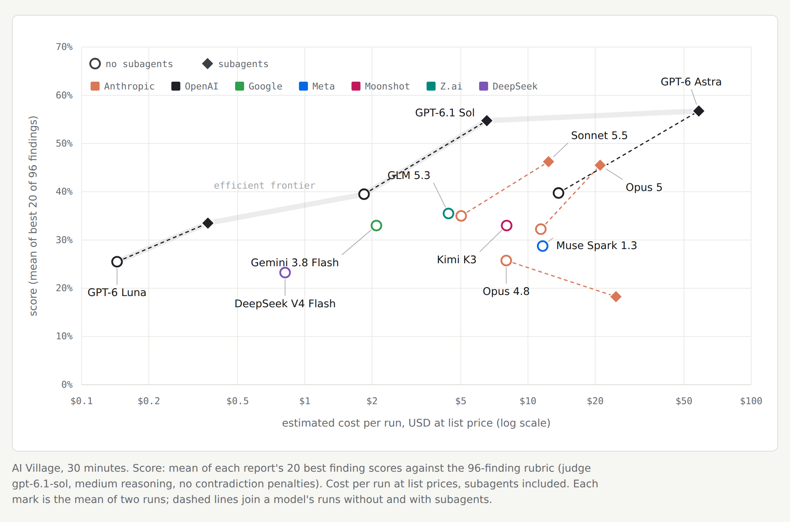

# Earlier experiments

These older figures use different model lineups, rubrics or judges and are not
directly comparable with the [current evaluation](../README.md).

Every plot below puts score against the estimated cost of a run at list prices, on a log
scale, with one colour per lab.

**German wiki.** The score is 70% finding coverage (38 findings from the human report) and
30% a judged TLDR. The best run, Opus 5 at 120 minutes, scores 51%; GPT-5.6 Sol reaches
49% for a seventh of the cost.

**Transluce.** The score is the weighted mean of 13 reviewed headline findings, each graded
by GPT-6 Astra. Three valid reports per model and time limit.

**AI Village.** The score is the mean of a report's 20 best scores against a 96-finding
rubric, graded by GPT-6.1 Sol. Of the six models run with and without subagents,
subagents raise five by 8 to 17 points and lower Opus 4.8 by 8. GPT-6.1 Sol with subagents
scores close to GPT-6 Astra with subagents at about a ninth of the cost. The judge has
since become stricter: regrading one published report on 21 October 2026 gave 0.41
against the published 0.62, so regrade old reports alongside new ones before comparing.

